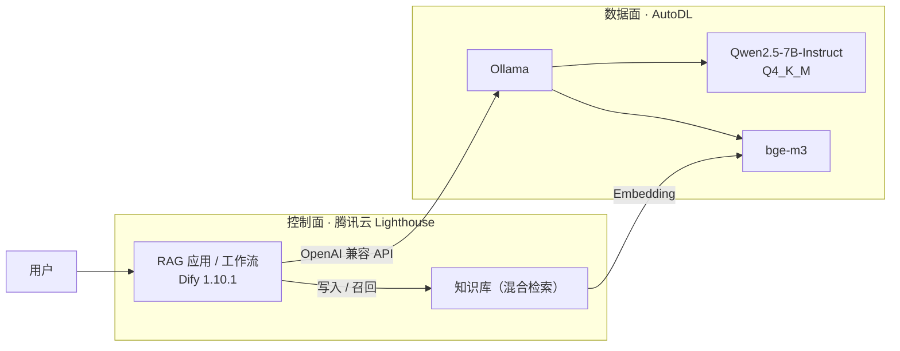
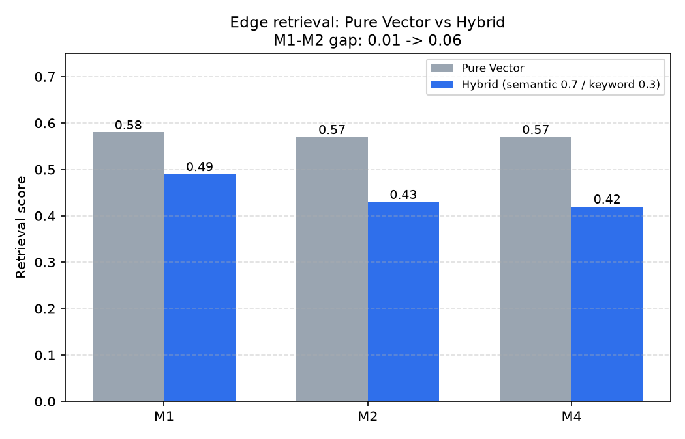
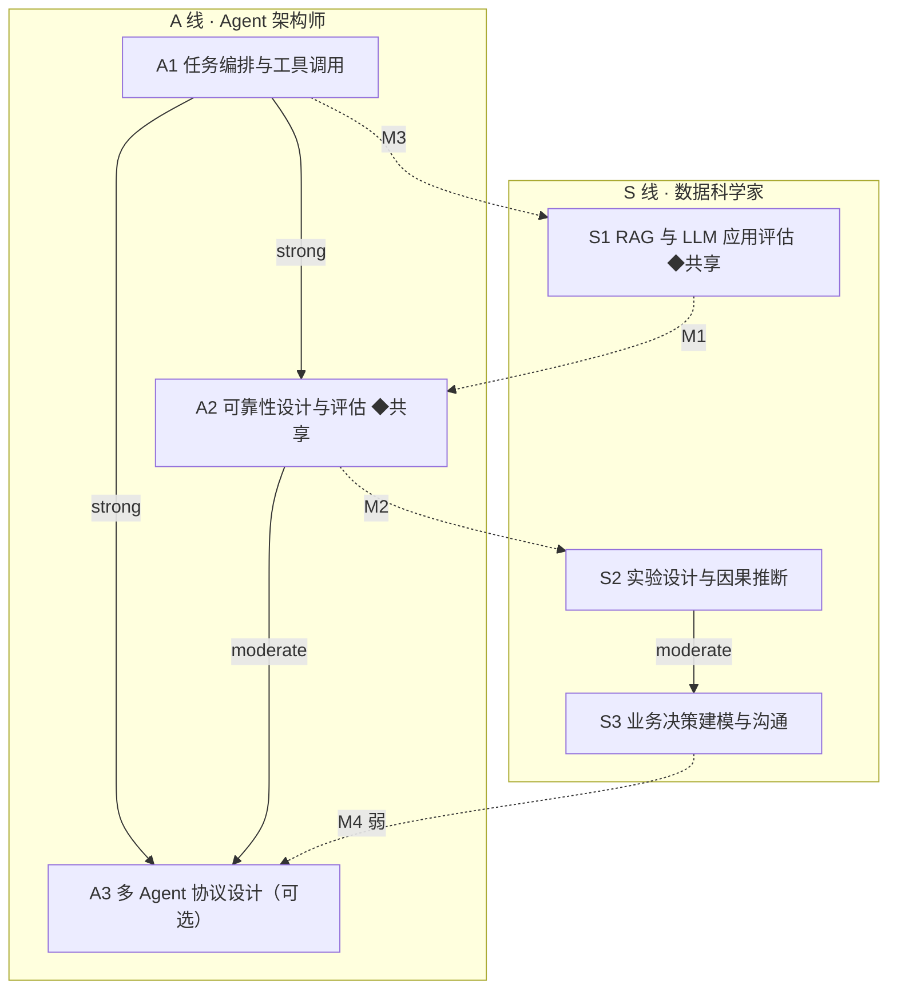

# AI Career Graph MVP

一句话定位：以 GitHub 为原生证据载体的 AI 职业岗位图谱，
用可追溯的工程决策（而非课程证书）作为能力通关判定。

## 架构

控制面（腾讯云 Lighthouse / Dify）与数据面（AutoDL / Ollama）
分离；LLM 为 Qwen2.5-7B-Instruct Q4_K_M，Embedding 为 bge-m3。

## S1 · RAG 召回调优（核心证据）

| 测试 | 配置 | M1 | M2 | M4 | M1−M2 区分度 |
|---|---|---|---|---|---|
| 1 | 纯向量，Top K=3 | 0.58 | 0.57 | 0.57 | 0.01 |
| 2 | 混合检索（0.7/0.3），Top K=3 | 0.49 | 0.43 | 0.42 | **0.06** |

**结论**：纯向量无法区分 `M1`/`M2`/`M4` 这类硬标识符；
混合检索的关键词通道将 M1 的领先从 0.01 扩大到 0.06，使 M1 稳定排第一。
完整调优记录见 [docs/s1-retrieval-tuning-log.md](docs/s1-retrieval-tuning-log.md)。

## 图谱定义

- [graph/nodes.yaml](graph/nodes.yaml) — 6 个节点（A1/A2/A3/S1/S2/S3）
- [graph/edges.yaml](graph/edges.yaml) — 4 条迁移边（M1—M4）
- [docs/graph.md](docs/graph.md) — Mermaid 可视化
- 校验：`python scripts/validate.py`

能力框架全景图（工具导出版，点击展开）

## 决策记录（ADR）

- [ADR-001](docs/decisions/) 控制面/数据面分离架构
- [ADR-002](docs/decisions/) 模型量化 Q4_K_M vs Q2_K
- [ADR-003](docs/decisions/) Dify 迁移至腾讯云 Lighthouse
- [ADR-004](docs/decisions/) Ollama 服务器重建与模型路径修正

## 证据入口

完整证据矩阵见 [PROOF_OF_WORK.md](PROOF_OF_WORK.md)。

## 当前进度

- ✅ 图谱 MVP 定义 + 校验脚本
- ✅ Dify + Ollama 跨云推理链路
- ✅ S1 召回调优（纯向量 → 混合检索，区分度 0.01 → 0.06）
- 🔄 A1 Agent 编排（进行中）

## 技术栈

Dify 1.10.1 / Ollama / Qwen2.5-7B-Instruct Q4_K_M / bge-m3 /
腾讯云 Lighthouse / AutoDL / Python + PyYAML
